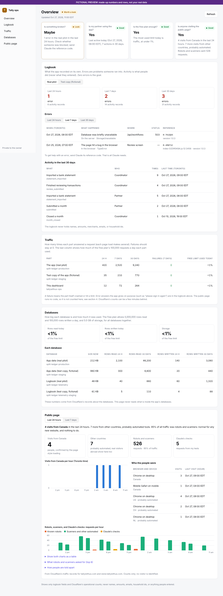

# Operations dashboard (WEB-052)

A private page at **https://ops.tallywithus.com** that only the owner can open. It shows, on
one screen:

1. **Logbook**: errors and activity from the pilot logbook `split-ledger-telemetry` for
   the last 24 hours, 7 days, and 30 days. Errors are listed with the time in Toronto,
   route or screen, status, error type, and reference code. A link switches to the fictional
   staging logbook.
2. **Workers**: requests and failures for `split-ledger-production`, `split-ledger-staging`,
   and this page's own Worker, from Cloudflare's analytics. The public page runs no code, so
   it never appears here (see 4).
3. **Databases (D1)**: size, rows read, and rows written for each database, from
   Cloudflare's records *about* the databases, plus how much of the free daily limits is used.
4. **Public page**: visits and requests for `tallywithus.com` and `www.tallywithus.com`
   for 24 hours and 7 days, from the zone's traffic records, and a table of what the last
   24 hours were made of. Robots and scanners are included, so "visits" are not people.

It is its own Cloudflare Worker, `tallywithus-ops`, kept in this `ops-dashboard/` folder. It is
separate from the app (`webapp/`) and the public page (`landing/`). Nothing here changes them.

*Fictional preview: every number and row in `preview/` is made up.*

## How to read the page

Start at the top box. It answers your four questions in one line each, with a colored dot:

| Question | Example answers |
|---|---|
| **Is something broken?** | "No. No errors in the real pilot in the last 7 days." / "Maybe: 1 error … send Claude the reference code." / "Probably: 6 errors …" |
| **Is my partner using the app?** | "Yes: last active today (time), 7 actions in 30 days." / "Not lately: last active 12 days ago." |
| **Is the free plan enough?** | "Yes. The most-used limit today is traffic, at under 1%." / "Yes, for now: … at 60%." / "Not for long: … at 85%." |
| **Is anyone visiting the public page?** | "Yes: 18 visits in the last 24 hours, 120 visits in 7 days." / "None recorded yet." |

Green dot: fine. Blue: information only. Amber: worth a look. Red: needs action.
The word above the answers sums them up:

| Word | Means | What to do |
|---|---|---|
| **All good** (green) | No answer is amber or red | Nothing |
| **Worth a look** (amber) | 1–4 errors in 24 hours, a crash, or a free limit over 50% | Read the amber answer and do what it says |
| **Needs action** (red) | 5 or more errors in 24 hours, or a free limit over 80% | Send Claude the reference codes or a screenshot of the box the same day |

Then, only if you need detail:

1. **Logbook.** Three boxes count errors for 24 hours, 7 days, and 30 days; red means there
   were some. The error list says *what happened* in plain words, *where* (a screen or an
   address in the app), and the **reference code**: send Claude that code, nothing else.
   Activity shows what people did and how often, which tells you whether the partner is
   actually using the app. **Real pilot / Test copy** switches between the real logbook and
   the fictional test one.
2. **Traffic.** Requests to each part (app, test copy, public page, this dashboard).
   "Failures" should be 0. "Free limit used today" shows the share of the free plan's
   100,000 requests a day.
3. **Databases.** Three boxes show how much of the free database limits is used today
   (reading, writing, storage). The table shows each database's size and use.
4. **Public page.** Visits and requests for tallywithus.com. Search engines and other bots
   are included, so real people are fewer.

Decisions the page helps with: is something broken that I should report, is the partner
using the app, is the free plan still enough, is anyone visiting the public page.

## Safety rules built into the code

- **Databases:** the Worker can only reach the two logbook databases
  (`split-ledger-telemetry` and the fictional `split-ledger-telemetry-staging`). It is never
  connected to `split-ledger-production` or `split-ledger-staging`. Three fixed `SELECT`
  queries are the only ones it runs (`src/logbook.ts`). The browser can only choose "24h",
  "7d", "30d", or "production"/"staging", never SQL. A test and the deploy guard
  (`scripts/deploy-guard.mjs`) refuse any other database.
- **Privacy:** the page shows only logbook fields and Cloudflare's operational counts. The
  logbook's household digest is never selected. Names, amounts, emails, household ids, and
  request bodies are never shown.
- **Who can open it:** Cloudflare Access asks for a one-time code sent to the owner's email.
  The Worker then checks Access's signed token itself (signature, issuer, this application's
  audience tag, expiry, and that the email is the owner's). So even a mistaken Access policy,
  such as one that lets "everyone" in, cannot expose the page. Until the Access settings are
  filled in, the page refuses everyone. There is no `workers.dev` or preview address.
- **Secrets:** the Cloudflare token is read-only (Account Analytics Read and D1 Read). The
  owner pastes it straight into Cloudflare as a Worker **Secret**. It is never in this
  repository, never printed, and never shown on the page.

## Files

| File | What it does |
|---|---|
| `src/index.ts` | Entry point: checks access first, then builds the one page |
| `src/auth.ts` | Cloudflare Access token check, and the password fallback |
| `src/logbook.ts` | The three fixed logbook queries |
| `src/cloudflare.ts` | Cloudflare analytics and D1 metadata requests |
| `src/render.ts`, `src/format.ts` | The page's HTML and the Toronto time and number formats |
| `wrangler.jsonc` | Worker name, address, the two logbook databases, plain settings |
| `scripts/deploy-guard.mjs` | Refuses a deploy that breaks the rules above |
| `scripts/fictional-logbook.sql`, `scripts/seed-local.mjs` | FICTIONAL rows for local trials |
| `test/` | Tests for the queries, formatting, access check, and the page |

## Commands (run inside `ops-dashboard/`)

| Task | Command |
|---|---|
| Install | `npm install` |
| Type check and tests | `npm run check` |
| Fill the local logbook copies with fictional rows | `npm run seed:local` (always local, never Cloudflare's databases) |
| Try it locally | Create `.dev.vars` with `AUTH_MODE=password` and `OPS_PASSWORD=<any 20+ characters>`, run `npm run dev`, open `http://localhost:8787` and enter that password. Stop with Ctrl+C. The three Cloudflare sections say the token is not set up, which is expected locally. |
| Deploy (agent, only after the owner approves) | `CONFIRM_DEPLOY=yes OWNER_EMAIL=<owner's Access email> npm run deploy` |

## Owner steps

These steps are for the owner. Each one says what you should see. Cloudflare sometimes
renames buttons. If a name differs slightly, pick the closest match. If anything looks
different from what is described, stop and ask.

### Step A: Turn on Cloudflare Access for ops.tallywithus.com (about 10 minutes)

*About Cloudflare Access:* it puts a sign-in screen in front of the page. You type your
email and Cloudflare emails you a 6-digit code. The Zero Trust **Free** plan costs $0 for up to
50 users ([Cloudflare plans](https://www.cloudflare.com/plans/sase-zero-trust.md)). We
could not confirm whether sign-up asks for a payment card for the free plan. If it does
and you'd rather not add one, use Step C instead. The code goes to **Hydrapeak8@gmail.com**
(owner decision 2026-10-26).

1. Go to https://dash.cloudflare.com and sign in to **Hydrapeak8@gmail.com's Account**.
2. In the left menu, click **Zero Trust**.
   - If this is your first time, Cloudflare asks for a **team name**. Type `tallywithus`
     (or another name if that one is taken). Your team domain becomes
     `<team name>.cloudflareaccess.com`. Write it down.
   - Choose the **Free** plan ($0, up to 50 users). Cloudflare may ask for a payment card even
     for the free plan. If you don't want to add one, stop here and tell me. We'll use the
     password option (Step C) instead.
3. Switch on email codes: in Zero Trust, go to **Integrations** (or **Settings**) →
   **Identity providers** (or **Authentication** → **Login methods**). If **One-time PIN**
   is not listed, click **Add new** and choose **One-time PIN** → **Save**. Without this,
   Cloudflare does not send codes.
4. In Zero Trust, go to **Access** (or **Access controls**) → **Applications** → **Add an
   application** → **Self-hosted**.
5. Fill in:
   - **Application name:** `Tally with us operations`
   - **Session duration:** `24 hours`
   - **Public hostname** (or **Application domain**): subdomain `ops`, domain
     `tallywithus.com`, path left empty.
6. Under **Policies**, choose **Add a policy** (or **Create new policy**):
   - **Policy name:** `Owner only`
   - **Action:** `Allow`
   - **Include** → selector **Emails** → type `Hydrapeak8@gmail.com`. Do **not** choose
     "Everyone" or an "Emails ending in" rule.
7. Under **Login methods** (or **Authentication**), make sure **One-time PIN** is selected.
8. Click **Save** (or **Next** until **Add application**).
9. Open the new application and find **Application Audience (AUD) Tag**, a long string of
   letters and numbers. Copy it.
10. Send me two things in the chat: the **team domain** (step 2) and the **AUD tag**
    (step 9). Neither is a secret. Do not send any token.

*What failure looks like:* there's no **Zero Trust** item, or Cloudflare insists on a paid
plan. Tell me and we'll use Step C.

### Step B: Create the read-only token and paste it into Cloudflare (about 5 minutes)

Do this after I tell you the Worker `tallywithus-ops` is deployed.

1. In https://dash.cloudflare.com, click the person icon (top right) → **My Profile** →
   **API Tokens** → **Create Token**.
2. Next to **Create Custom Token**, click **Get started**.
3. **Token name:** `tallywithus-ops read-only`.
4. **Permissions**, set two rows (use **+ Add more** for the second):
   - `Account` | `Account Analytics` | `Read`
   - `Account` | `D1` | `Read`
   - `Zone` | `Analytics` | `Read`

   Nothing else. No "Edit" permissions.
5. **Account Resources:** `Include` | `Hydrapeak8@gmail.com's Account`. **Zone Resources:**
   `Include` | `Specific zone` | `tallywithus.com`.
6. Leave the other fields as they are. Click **Continue to summary**, check that it lists
   only the three "Read" permissions, then click **Create Token**.
7. Click **Copy** to copy the token. Cloudflare shows it only once. Don't paste it into the
   chat, an email, or a file.
8. Go to **Workers & Pages** → **tallywithus-ops** → **Settings** → **Variables and
   Secrets** → **+ Add**.
   - **Type:** choose **Secret** (not Text)
   - **Variable name:** `CF_ANALYTICS_TOKEN`
   - **Value:** paste the token
9. Click **Deploy** (or **Save and deploy**).
10. Reload https://ops.tallywithus.com. Sections 2 and 3 now show numbers instead of "The
    read-only Cloudflare token is not set up yet".

*What failure looks like:* a section says "Cloudflare answered 400: Authentication
failed". The token was copied incompletely. Repeat steps 7 to 9 with a new token and delete
the old token in **API Tokens**. Or a section says "Cloudflare answered 403". One of the
two permissions in step 4 is missing.

### Step C (only if you decline Zero Trust): one password

1. Tell me you prefer a password. I switch `AUTH_MODE` to `password` and redeploy (with your
   approval).
2. Make a long password (at least 20 characters, for example from your password manager)
   and save it in your password manager.
3. In Cloudflare: **Workers & Pages** → **tallywithus-ops** → **Settings** → **Variables
   and Secrets** → **+ Add** → Type **Secret**, name `OPS_PASSWORD`, value your password →
   **Deploy**.
4. Open https://ops.tallywithus.com. The browser asks for a user name (type anything) and
   the password.

### Checking the page (after Step A, and again after Step B)

1. In a **private browser window**, open https://ops.tallywithus.com.
2. Expected: a Cloudflare page asks for your email. Enter it. You get a 6-digit code by
   email. Enter it. The page **Tally with us — operations** opens with four numbered
   sections.
3. In another private window, try an email that is *not* yours. Expected: Cloudflare does
   not send a code, and the page does not open.
4. *What failure looks like:* the page shows "Not available: Not allowed." after the code.
   The email in Access and the email I deployed with don't match. It must be
   Hydrapeak8@gmail.com. If it says "Access is not configured yet.", I haven't entered the AUD tag yet.

## Public page numbers (section 4)

**Rule for the agent:** every check the agent makes against a tallywithus.com address sends
the user agent `tallywithus-agent-check` (for example `curl -A tallywithus-agent-check …`),
so it shows as "Claude's checks", not as people or scanners.

The public page (`tallywithus-landing`) serves static files only, and its security policy
blocks Cloudflare's Web Analytics script. So neither Worker counts nor Web Analytics can see
it. Section 4 instead reads the zone's request records (`httpRequestsAdaptiveGroups`) for
`tallywithus.com` and `www.tallywithus.com`, leaving out Cloudflare's own traffic
(`requestSource: "eyeball"`). This needs **Zone · Analytics · Read** on the read-only token
(added by the owner 2026-10-26) and the zone id in `wrangler.jsonc` (not secret). Each
window is a separate request, so a window the free plan does not keep shows "Not kept"
without hiding the others.

## Open issues and next steps

1. **Public page numbers are not reliable yet (owner, 2026-10-26: refine later, not now).**
   Cloudflare's server-side counts mix people with robots, and the free plan withholds the
   network field that would separate them. The current rules (style or font must load,
   Canada split) matched the owner's real visits once, but they are guesses. Next approach
   to choose, all needing a change in `landing/` (separate branch):
   - **Google Analytics or Amplitude:** real visitor and session tracking with a script on
     the public page. Needs the page's security policy opened for their scripts, and very
     likely a cookie notice (Canada, Quebec Law 25). Amplitude suits product events later.
   - **Cloudflare Web Analytics:** free, cookie-free script that counts real browsers only.
     Needs the same policy change, but no cookie notice, and keeps data in Cloudflare.
   - Then section 4 reads that tool's numbers, or links to its dashboard.
2. **SaaS-style redesign:** done 2026-10-26 (see the log).
3. **Moving these notes into `docs/`:** when the owner asks to merge `ops-dashboard` by pull
   request.

## Status log

- **2026-10-26 (SaaS redesign):** light SaaS look after two references: Vercel's dashboard
  (sidebar, grey canvas, hairline white cards, one accent) and Stripe's home (overview row
  of status cards). The four questions are cards with a status pill and a big short answer
  ("Yes", "Maybe") over the detail; segmented time switches; quieter tables. System font
  only, no scripts (the security policy allows neither). Works at phone width and in dark
  mode. 62 tests pass. Not deployed yet.
- **2026-10-26 (Canada split, owner decision):** with the style rule, the live page showed 14
  visits by people: 3 from Canada (matching the owner's 2–3 desktop visits and one phone
  visit by his wife) and 11 from the US, Switzerland, and the Netherlands (tools running a
  real browser engine). People are now split by country (`HOME_COUNTRIES` in
  `src/traffic.ts`): "Visits from Canada" is the main number, chart, and top-box answer;
  other countries are shown apart as "probably automated", since real visitors abroad
  land there too. A test reproduces the live reading (3 and 11). 61 tests pass. Deployed
  (owner approved).
- **2026-10-26 (81 "people"):** live, without the network field the page counted 81 visits by
  people, mostly Chrome and Firefox from Germany, the US, Poland, and the Netherlands:
  scanners posing as browsers. A page load now counts as a person only when the same
  hour, browser, device, and country also downloaded the page's style or font; the rest is
  "a program posing as a browser". Repeat visits that reuse the cached style are missed,
  so the count leans low. 60 tests pass.
- **2026-10-26 (free plan withholds a field):** live, Cloudflare refused the request because
  the free plan does not give `clientASNDescription` (network). The page now drops any
  optional field Cloudflare refuses, retries, and says which ones are missing; without the
  network, scanners disguised as browsers are harder to tell from people. 58 tests pass.
  Deployed (fix within the approved section).
- **2026-10-26 (public page redesign: who visited):** after the owner's ground truth (about
  3–4 real visits, against 137 "visits" reported), section 4 sorts each request group
  (`src/traffic.ts`) into **people** (recognised browser, home or mobile network, a real page
  file, delivered), **known robots** (Cloudflare's verified bot label), **scanners and other
  automated**, and **Claude's checks** (user agent `tallywithus-agent-check` from now on;
  earlier curl or Node checks count as "likely"). It shows a one-line takeaway, three
  tiles, a people-only chart and a robots chart on their own scales (no shared axis), who
  the people were with their last visit, and folded tables. There is a 24 hours / 7 days
  switch; one Cloudflare request per load, so all numbers agree. The chart is HTML/CSS (the
  page allows no scripts), with native tooltips and a table twin; the palette was
  validated for colour-blind safety in both modes. A fictional test modelled on the
  owner's case lands on 4 people visits. 57 tests pass. Deployed as version
  `f1ed17eb-468b-4cc9-9f10-1898e973a8e3` (owner approved); both secrets kept.
- **2026-10-26 (public page numbers did not add up):** the first live reading showed 137
  "visits" and 769 requests in 24 hours, where the owner expects about 3 real visits, and
  100 visits for 30 days (fewer than for 7 days, which is impossible). Likely causes:
  automated scanners and robots, which find new websites within hours, and Cloudflare
  estimating long ranges from samples on the free plan. Changes: the 30-day box is
  dropped for the public page; the top-box answer says "Unclear" instead of "Yes"; and
  section 4 shows what the last 24 hours were made of (page address, answer, browser or
  known robot, network, device; never addresses or full browser strings), with plain
  shares of refused requests, known robots, and non-browsers. 50 tests pass. Not deployed yet.
- **2026-10-26 (public page numbers, option A):** the owner added `Zone · Analytics · Read`
  for `tallywithus.com` to the read-only token. Section 4 and the top-box answer now use the
  zone's request records. The public page was removed from the Worker table, where it
  always showed 0. Field names were checked against Cloudflare's published schema; the live
  query could not be run from the agent's container (its own token lacks that permission),
  so it is first proven on the deployed page. 49 tests pass. Deployed as version
  `0bc3fb49-ff79-43fa-a524-d0a44eba1193` (owner approved); both secrets kept; page still
  answers 401 without the password.
- **2026-10-26 (live, first findings):** the owner set `OPS_PASSWORD` and `CF_ANALYTICS_TOKEN`
  (both stored as Secrets) and opened the page. First findings from the real numbers:
  - Production logbook: household created, partner invited, and partner joined within 8
    minutes (activity only). One error, reference `47AC7026` (503 on `/api/me`,
    `AuthenticationUnavailable`), from before the Clerk secret was set (R6). It is not a defect.
  - All free-plan use is far below 2%. The largest is staging test runs (about 1,200 rows
    written a day).
  - **Blind spot:** the public page shows 0 requests and 0 visitors, but that is not real.
    `tallywithus-landing` serves static files only, so no Worker code runs and Cloudflare's
    Worker counts never include it. Its content-security policy also blocks Cloudflare's Web
    Analytics script, so visitor statistics stay empty. Options: add `Zone · Analytics ·
    Read` for `tallywithus.com` to the read-only token and read the zone's request counts
    per host (no change to the public page), or allow the beacon in `landing/` (separate
    branch and session). Waiting for the owner's choice.
- **2026-10-26 (password mode):** Zero Trust's Free plan asked for a payment card, so the owner
  chose the password option (Step C) instead. `AUTH_MODE` is now `password`; version
  `a7a39a82-6796-443e-b4e8-17c82156ca56`. Until the owner adds the `OPS_PASSWORD` secret
  (20+ characters), the page answers 503 "The password is not configured yet."
  (checked, also with a guessed password). Step A is no longer needed.
- **2026-10-26 (deployed):** the owner approved. `tallywithus-ops` version
  `59283f06-b872-423d-8e3f-52b8607a0da5` is at `ops.tallywithus.com` (custom domain) with
  bindings `TELEMETRY` and `TELEMETRY_STAGING` only, `AUTH_MODE=access`, and owner email
  Hydrapeak8@gmail.com. Checks: `https://ops.tallywithus.com/` answers 503 "Access is not
  configured yet." (also with a fake Access token), with `no-store`, the strict security
  policy, and `noindex`. `app.tallywithus.com` and `www.tallywithus.com` still answer 200.
  Next: owner Step A (Access), then the agent fills in `ACCESS_TEAM_DOMAIN` and `ACCESS_AUD`
  and redeploys; then owner Step B (read-only token).
- **2026-10-26 (later):** made easier to read after the owner's review: an "at a glance"
  box with a verdict and what to do (`src/health.ts`), plain names for events, errors,
  screens, Workers, and databases (`src/labels.ts`), a one-line "how to read" under each
  section, and the phone layout. Then the box was changed to answer the owner's four
  questions directly, one line each. 48 tests pass. Fictional previews in `preview/`. Access code
  email: Hydrapeak8@gmail.com. Not deployed at that point.
- **2026-10-26:** built on branch `ops-dashboard`. 39 tests pass. Tried locally with
  fictional logbook rows (password mode, local database copies only) at desktop and phone
  widths. The three Cloudflare sections were checked against the real analytics API with
  operational counts only. Cloudflare had not yet named traffic for
  `split-ledger-production` and `tallywithus-landing` (both deployed that hour), so they
  showed 0. Not deployed yet: waiting for the owner's approval and Step A.
- **Moving notes into `docs/`:** when the owner asks to merge this branch by pull request,
  the operations parts of this file move into `docs/WEBAPP.md` and WEB-052 is updated in
  `docs/WEBAPP-BACKLOG.md`.
